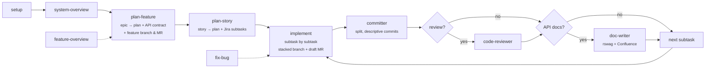
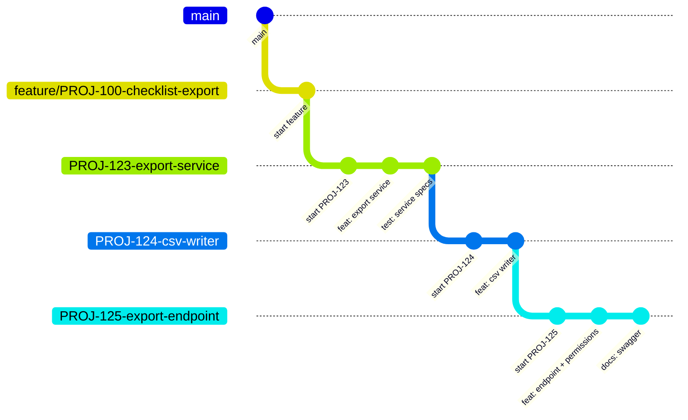

<div align="center">

# 🛠️ ai-sdlc-workflow

**A Claude Code plugin and a local dashboard that run the Rails backend lifecycle — from a Jira epic to reviewed, documented, merged code — on any Rails project.**


`/backend:setup` · `/backend:plan-feature` · `/backend:plan-story` · `/backend:implement` · `/backend:review` · `/backend:fix-bug` · `backend-dash`


</div>

---

## Contents

- [Why](#why)
- [Install](#install)
- [Quick start](#quick-start)
- [Using the dashboard](#using-the-dashboard)
- [The workflow](#the-workflow)
- [Skills](#skills)
- [Subagents](#subagents)
- [What it creates in your project](#what-it-creates-in-your-project)
- [Hooks](#hooks)
- [Token & time budget](#token--time-budget)
- [Optional status line](#optional-status-line)
- [Updating](#updating)
- [Troubleshooting](#troubleshooting)

## Why

Backend work is the same loop every time: understand the system → understand the feature → plan → split into tickets → branch → implement → commit → review → document. The rules for each step usually live in people's heads.

This project turns that loop into Claude Code skills, plus a dashboard to drive them:

- 🔌 **Drops onto any Rails project** — nothing company-specific is hardcoded; every project detail lives in one `.claude/backend.yml` that `/backend:setup` detects for you.
- 🧭 **Never loses the thread** — every feature and bug has a `context.md` that says where you stopped and what's next. Open a new session tomorrow, or hand the file to a teammate, and it continues from there.
- 🌳 **Ships in small, reviewable pieces** — one stacked branch + draft MR per Jira subtask, commits split by logical unit.
- 📮 **Hands you a ready Postman collection** — `/backend:postman` turns the APIs a ticket changed into a versioned collection with chained requests, error cases and real local IDs.
- 🛡️ **Guards the basics** — hooks block debug statements, plain force-pushes and commits on the base branch.
- 🖥️ **Shows everything in one place** — the dashboard browses `.plans/`, builds the right command for the ticket you have open, runs it in Claude Code tabs and tells you when a session needs you.
- 💸 **Stays cheap** — big plans are read section by section, agents only where they pay off, state written at checkpoints only.

## Install

### Requirements

| For | You need |
|-----|----------|
| The plugin | Claude Code · any Ruby ≥ 2.6 on `PATH` (the macOS system Ruby is enough — helper scripts are stdlib-only, no bundler) · git |
| Git host | `glab` (GitLab) or `gh` (GitHub), logged in |
| Jira / Confluence | Atlassian MCP connected in Claude Code |
| Designs | Figma MCP (optional) |
| Bug verification in the browser | Claude in Chrome — start Claude with `claude --chrome` (optional) |
| The dashboard | macOS or Linux · Node.js 18.17+ (Linux: 20+ for live file watching) · `curl` |

### 1. Get the code

```bash
git clone git@github.com:AhmadFawzyFcih/ai-sdlc-workflow.git ~/ai-sdlc-workflow
```

### 2. Install the plugin

```bash
# Register the local marketplace (once per machine)
claude plugin marketplace add ~/ai-sdlc-workflow

# Install it inside your Rails project
cd ~/code/my-rails-app
claude plugin install backend@ai-sdlc-workflow --scope local
```

| Scope | Who gets it |
|-------|-------------|
| `--scope local` *(recommended)* | Only you, only this repo — non-Rails projects pay nothing |
| `--scope project` | The whole team (writes `.claude/settings.json`) |
| no flag | Every project on this machine |

The marketplace is read **in place**: edit anything in `~/ai-sdlc-workflow`, then start a new session or run `/reload-plugins`. To try it once without installing: `claude --plugin-dir ~/ai-sdlc-workflow/plugins/backend`.

### 3. Install the dashboard

Nothing to build. The launcher installs its own dependencies on the first run (`npm install`, ~10 s).

Make it a command you can type from anywhere:

```bash
mkdir -p ~/.local/bin
ln -sf ~/ai-sdlc-workflow/dashboard/bin/backend-dash ~/.local/bin/backend-dash
```

Make sure `~/.local/bin` is on your `PATH` (add `export PATH="$HOME/.local/bin:$PATH"` to `~/.zshrc` if it isn't).

## Quick start

```bash
cd ~/code/my-rails-app
claude
```

```text
/backend:setup                                   # once per project → .claude/backend.yml
/backend:system-overview                         # optional: map the codebase
/backend:plan-feature https://…/browse/PROJ-100  # epic → feature plan, API contract, feature branch + MR
/backend:plan-story PROJ-101                     # story → plan with stacked subtasks → Jira
/backend:implement PROJ-101                      # subtask by subtask, branch + draft MR each
```

Stopped halfway? Run `/backend:resume PROJ-101` in any new session — or just check out the branch; the session hook loads where you left off.

Prefer clicking? Start the dashboard and do all of the above from the browser:

```bash
backend-dash --project ~/code/my-rails-app
```

## Using the dashboard

A local web UI on top of the plugin. It shows your `.plans/` workspace, builds the right `/backend:*` command for the ticket you have open, and runs it in **real Claude Code sessions inside browser tabs**. Everything runs on your machine — the server listens on `127.0.0.1` only.

### Start it

```bash
backend-dash --project ~/code/my-rails-app     # opens http://127.0.0.1:4545
backend-dash                                   # from inside a git repo: adds the current folder
```

| Option | |
|--------|---|
| `--project <path>` | Add this project and show it first |
| `--port <n>` | Default `4545` (or `$BACKEND_DASH_PORT`) |
| `--open` / `--no-open` | Open the browser (default when started from a terminal) |
| `BACKEND_DASH_CLAUDE=<path>` | The Claude Code binary to run (default `claude`) |

Keep the terminal open (or run it in a tmux pane) while you work. `Ctrl+C` stops the dashboard **and every Claude session it started**.

### A typical session

1. **Pick a ticket** — type `PROJ-101` in the sidebar filter and open its folder.
2. **See where you are** — the folder tab shows *Where you stopped*, every story (*Planned / Not planned*) and, per story, its subtasks with branch, MR and **You are here**.
3. **Run the next step** — each story and subtask has its command ready (`/backend:plan-story`, `/backend:implement`, `/backend:address-review`). Click **Run in a Claude tab**, or **Copy command** to paste it in your own terminal.
4. **Or start from Home** — pick any skill under *Run a skill*; the form is pre-filled from the open ticket and the right plan file is auto-picked (★).
5. **Walk away** — leave the Claude tab whenever you want; the session keeps running. When Claude needs an approval you get a toast in the bottom-right corner, a `(1)` in the browser tab title and a desktop notification. Click it to jump back.
6. **Read the results** — plans open rendered with an outline, API contracts and review reports in a sandboxed frame.


### What's on screen

| Area | What it does |
|------|--------------|
| **Sidebar** | The project's `.plans/` tree, collapsed until you open a folder. Filter by ticket or file name. Each row has copy path, download (folders as `.zip`) and move to Trash (asks first). A click opens a preview tab; double-click a tab to keep it. Drag its edge to resize; hide it with the top-left button or ⌘B / Ctrl+B. |
| **Home** | Every Claude session the dashboard started — *Needs you* · *Running* (with what it's doing now) · *Waiting for you* · *Ended* — for the environment you have open, filterable by status, plus the skill forms. Sessions that need you elsewhere are counted on the project switcher. |
| **Tabs** | Drag a tab before or after another one, like browser tabs; Alt+Shift+←/→ moves the focused tab. Home stays first; the order is remembered per project. |
| **Folder tab** | Epic, story and subtask keys open in Jira; chips for Jira · **Docs** (the Confluence docs page you told Claude about) · API contract · other links · MR. Where you stopped, stories, subtasks, next step, open questions, decisions and the folder's files — each with its ready command. |
| **File tab** | Markdown with an outline, HTML in a sandbox, JSON pretty-printed. *Copy path* and *Open in editor*. |
| **Claude tab** | Real Claude Code (xterm.js) started in the project folder. *Stop session* asks first; *Reopen conversation* resumes a saved conversation. |
| **Top bar** | The project button lists every project, with each project's **worktrees** under it (↗ opens one in a new browser tab — each tab keeps its own project), **Worktrees** and **Monitor**, dark / light theme, live clock with a calendar. |
| **Worktrees** | One git worktree per branch with its own backend, frontend, Redis and ports — and a shared, private-copy or fresh database. Migrations on the shared database ask first and can be rolled back; *Delete* cleans up containers, volumes, database and folder. Each worktree has an **Environment** tab with its steps (`docker compose run web bash` · migrate · up · `yarn install` · Vite). |
| **Monitor** | Memory and CPU per worktree (containers, Vite, Claude), Docker and Mac memory, disk per worktree. |


Session status, worktrees (ports, databases, settings), security model, options and dashboard troubleshooting: [`dashboard/README.md`](dashboard/README.md).

## The workflow



`/backend:full-cycle` chains it all and pauses only at real decisions. `/backend:resume` picks any feature or bug back up from its `context.md`.

### Stacked subtasks

Each Jira subtask gets its own branch on top of the previous one, and its own **draft MR** targeting that branch — every MR shows only its own diff.



## Skills

| Skill | What it does |
|-------|--------------|
| `/backend:setup` | Detects Rails/Ruby, test & API tooling, git host, base branch, Jira key → writes `.claude/backend.yml` |
| `/backend:resume [KEY] [file.md]` | Loads a work item's state + `context.md`, checks git/MR reality, proposes the next step — continuing from the plan file you name |
| `/backend:system-overview` | HTML overview of the codebase (business, domains, integrations, flows, hotspots) + a short `overview.md` other skills reuse; cached and refreshed incrementally |
| `/backend:feature-overview` | Hand-over briefing on one feature: business and technical picture, done / in progress / left, where to continue |
| `/backend:analyze-requirements` | Jira stories vs Figma designs mismatch report (optional Confluence) |
| `/backend:plan-feature` | Epic + thoughts → `feature-plan.md`, `api-contract.html` with JSON examples (optional Confluence), feature branch + draft MR. Re-run to update in place |
| `/backend:plan-story` | Story (+ main plan file, Figma) → detailed plan with stacked subtasks → you confirm → created in Jira (you as assignee/reporter, parent labels or `--labels`, ready status) |
| `/backend:implement` | Subtask by subtask: stacked branch + draft MR, code + specs, committer agent, one MR comment per step, optional review and docs gates. A subtask key = only that subtask; optional story plan path and `--thoughts`. `--bugfix` mode for fix-bug |
| `/backend:review` | Rails checklist → interactive HTML report in the work item's `reviews/` folder; fixes locally or comments on an MR. `--out <dir>` sets the folder |
| `/backend:address-review` | Handles reviewers' comments on your MR: fix or reply, push, answer the threads |
| `/backend:postman` | Postman collection (v2.1) for the APIs a ticket, MR or the current branch changed: numbered folders, chained IDs, 404/422/403 cases, real IDs from your local database (read-only, via `app.runner_cmd`). Saved as `<KEY>-v<N>.postman_collection.json` in the ticket's `postman/` folder — every run adds the next version |
| `/backend:document` | rswag/Swagger specs first, then a new Confluence API page or a reviewed update |
| `/backend:fix-bug` | Two investigators find the root cause → failing spec → fix → commits → optional review → steps to reproduce re-run in Chrome |
| `/backend:full-cycle` | The whole epic workflow, pausing only at decisions; resumable |
| `rails-` / `rspec-` / `api-conventions` | Load automatically when matching files are touched (not in the `/` menu) |

## Subagents

| Agent | Used by | Job |
|-------|---------|-----|
| `system-explorer` | system-overview | Explores the codebase area by area and writes the overview |
| `feature-explorer` | feature-overview | Reconciles Jira, branches, MRs and code for one feature |
| `requirements-analyst` | analyze-requirements | Jira ↔ Figma mapping and mismatches |
| `bug-investigator` | fix-bug (×2 in parallel) | Code path (incl. data/config) · regression history |
| `committer` | implement, fix-bug | Split, descriptive commits + push |
| `code-reviewer` | implement, fix-bug, full-cycle | Runs the review skill (local) and writes the report — no fixes |
| `doc-writer` | implement, document | rswag + Confluence |

## What it creates in your project

```text
.claude/backend.yml                         ← project config (no secrets)
.plans/
├── _system/overview.html · overview.md
├── features/PROJ-100-checklist-export/
│   ├── state.json                          ← stories, subtasks, branches, MRs, stage
│   ├── context.md                          ← where we stopped + next step (shareable)
│   ├── events.jsonl                        ← milestone log
│   ├── feature-plan.md · api-contract.html
│   ├── reviews/                            ← review reports not tied to a story
│   └── stories/PROJ-101/{plan.md, subtasks.md, reviews/, postman/}
├── bugs/PROJ-555-export-timeout/
│   └── state.json · context.md · events.jsonl · investigation.md · plan.md · screenshots · reviews/ · postman/
├── reviews/                                ← review reports with no work item (someone else's MR, ad-hoc diff)
├── postman/                                ← Postman collections with no work item
├── requirements/                           ← requirements reports with no epic
└── overviews/                              ← feature overviews with no work item
```

Every file lives in one of these folders — nothing is written loose at the top of `.plans/`. Review reports go to the matching `reviews/` folder and Postman collections to the matching `postman/` folder (story → feature/bug → top-level). Plans are edited in place and keep a `## Changelog` table at the bottom — no `-rev-N` copies.

## Hooks

| When | What happens |
|------|--------------|
| Session starts on a feature/subtask/bug branch | Its state + `context.md` are loaded, so Claude already knows where you stopped |
| `git commit` | Blocked if staged Ruby contains `binding.pry`, `byebug`, `debugger`, stray `puts`/`p` |
| `git push --force` | Blocked — only `--force-with-lease`, and only after you confirm |
| Commit / push on the base branch | Blocked |

Hooks only act in projects that have `.claude/backend.yml`.

## Token & time budget

| What | How |
|------|-----|
| Always-on cost | ~1.2k tokens per session for all skill/agent descriptions; install with `--scope local` so non-Rails projects pay nothing |
| Big plans | Read by section: `plans.rb outline <file>` → `plans.rb section <file> "<heading>"` (one phase of a 68 KB plan ≈ 6 KB) |
| Shared rules | ~11 KB total, opened only when a step needs them |
| Agents | fix-bug: 2 · plan-feature / plan-story: at most 1 `Explore` · system-explorer: no nested agents · review gate: 1 |
| State writes | `context.md` and events only at checkpoints (end of subtask, gates, stop) — not per step |
| Questions | Architecture talk = one question round (≤ 4 questions) per story, skipped when decisions are already in the plan |

## Optional status line

Add to `~/.claude/settings.json`:

```json
"statusLine": { "type": "command", "command": "ruby ~/ai-sdlc-workflow/plugins/backend/scripts/statusline.rb" }
```

```text
⎇ PROJ-124-csv-writer · PROJ-100 › PROJ-124 (2/4) · implement · Opus
```

## Updating

```bash
cd ~/ai-sdlc-workflow && git pull
```

Then start a new Claude session (or run `/reload-plugins`) and restart `backend-dash`. New dashboard dependencies are installed automatically on the next start.

## Troubleshooting

| Problem | Fix |
|---------|-----|
| `/backend:*` commands don't show up | Check `claude plugin list`; install in this project with `claude plugin install backend@ai-sdlc-workflow --scope local` |
| Hooks or skills say the project isn't set up | Run `/backend:setup` once in the project |
| `ruby: command not found` in hooks | Any Ruby ≥ 2.6 on `PATH` is enough — the macOS system Ruby works |
| `backend-dash: command not found` | Add `~/.local/bin` to your `PATH`, or run `~/ai-sdlc-workflow/dashboard/bin/backend-dash` |
| `Port 4545 is busy` | The dashboard is already running — open <http://127.0.0.1:4545>, or use `--port 4546` |
| `claude: command not found` in a dashboard tab | Start the dashboard from a terminal where `claude` works, or set `BACKEND_DASH_CLAUDE=/full/path/to/claude` |
| Sidebar says no `.plans/` | Run `/backend:setup` (or any planning skill) in that project once |

More dashboard fixes: [`dashboard/README.md#troubleshooting`](dashboard/README.md#troubleshooting).

## License

[MIT](LICENSE) © Ahmed Fawzy
