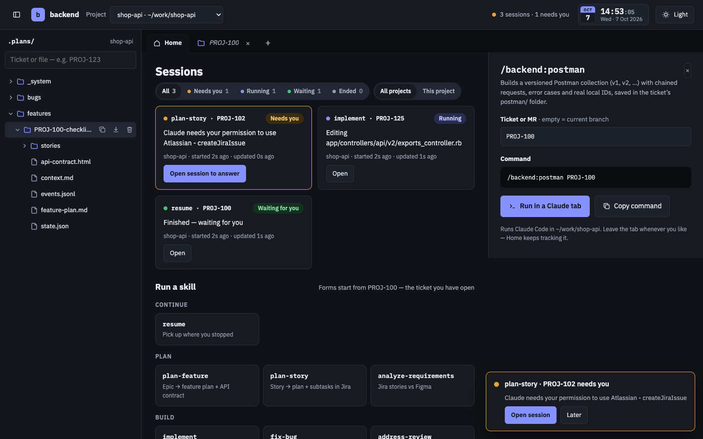
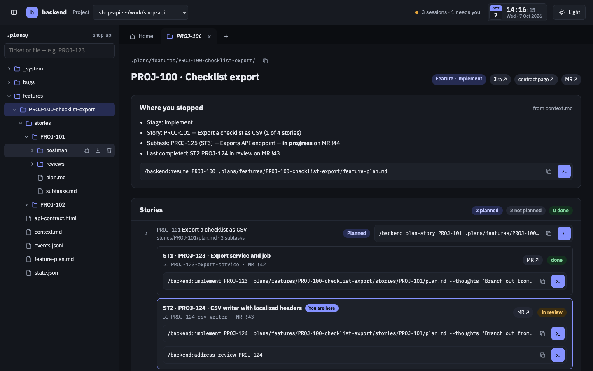
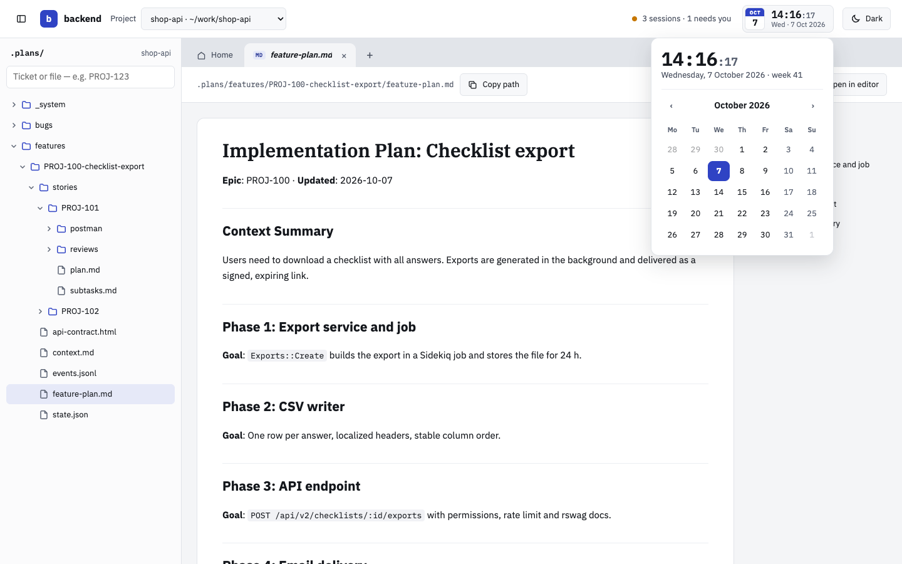
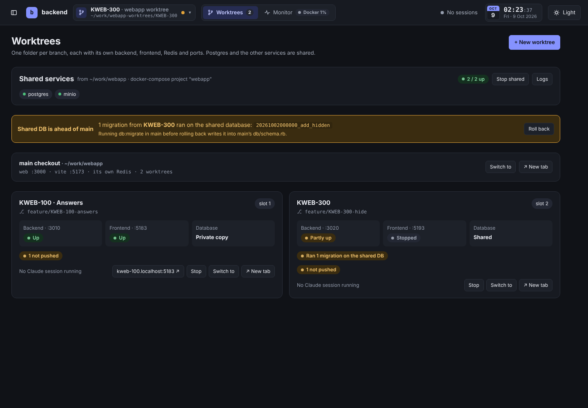
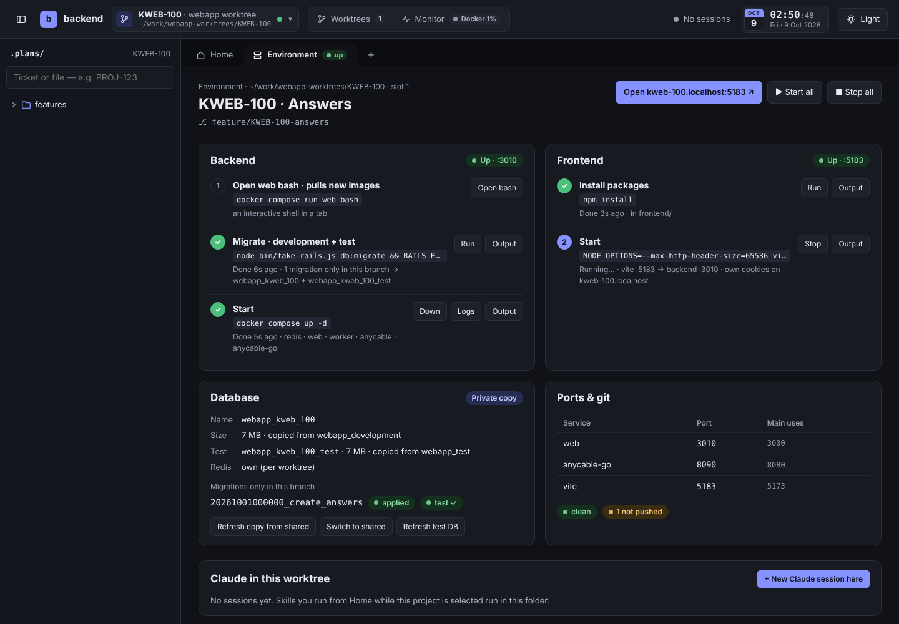
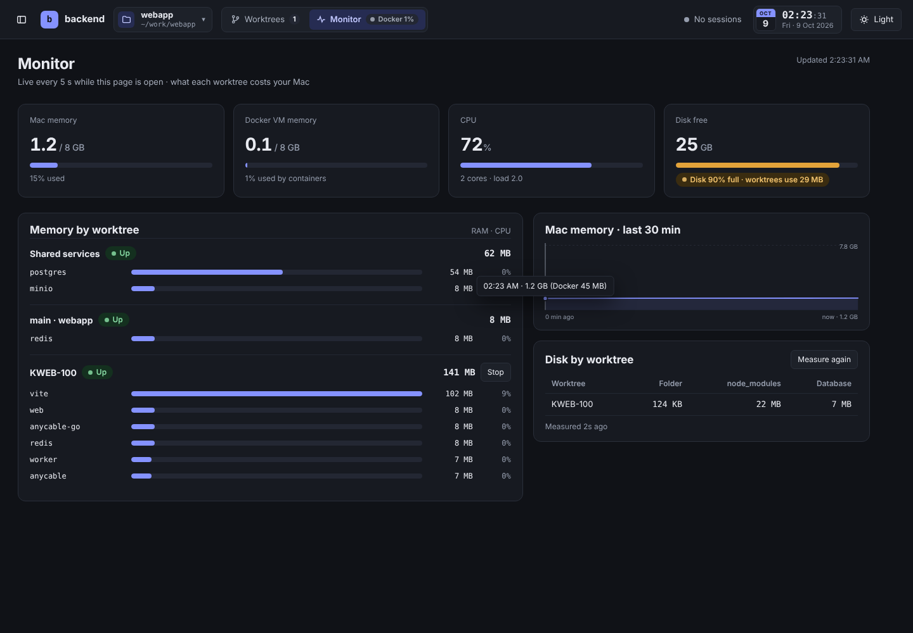

# backend dashboard

A local web UI for the [`backend` Claude Code plugin](../plugins/backend). It shows your `.plans/` workspace, builds the right `/backend:*` command for the ticket you have open, and runs it in **real Claude Code sessions inside browser tabs** — while the Home page tracks every session live and tells you when one needs your approval.

It also runs **one git worktree per branch**, each with its own backend, frontend, Redis and ports (and, if you want, its own database), next to your main checkout — see [Worktrees](#worktrees).

Everything runs on your machine. The server listens on `127.0.0.1` only.













## What you get

| Area | What it does |
|------|--------------|
| **Sidebar** | The `.plans/` tree of the open project — folders before files. It starts collapsed: only the top-level folders show until you open one. Type a ticket (`PROJ-101`) or a file name to filter. Hover a row (or tab to it) for its actions: **copy path** (from `.plans/…`), **download** (folders as `.zip`) and **move to Trash** (asks first; restore it from the Trash). Clicking opens a *preview* tab (italic) that the next click replaces; double-click a tab to keep it. Drag the sidebar's right edge to resize it (arrow keys when focused; double-click resets); the button at the top-left or **⌘B** / **Ctrl+B** hides and shows it. Width and visibility are remembered. |
| **Home** (top bar) | **Sessions** — the Claude sessions of the environment you have open (the main checkout or one worktree): *Needs you* · *Running* (with what it is doing right now) · *Waiting for you* · *Ended*. Filter by status; *Dismiss* one ended session or *Clear ended* all at once. **Run a skill** — pick a skill, a form opens on the right, already filled from the ticket you have open. |
| **Skill forms** | Every `/backend:*` skill with its arguments. Ticket fields default to the open ticket; plan fields **auto-pick the right `.md`** (story plan › feature plan › older plans with the key in the name › `context.md`), marked ★ in the list. The command updates as you type — **Copy command** or **Run in a Claude tab**. |
| **Folder tab** | For a work item folder (each subtask also has a status menu — *pending · in progress · committed · in review · done* — to set it by hand; it is written to `state.json` and logged in `events.jsonl`): the epic, story and subtask keys open in Jira; chips next to the title show Jira · **Docs** (the feature's Confluence documentation, once you've told Claude which page it is) · API contract · other links · MR; *Where you stopped* (from `context.md`) with its `/backend:resume` command; every story with *Planned / Not planned*, a *2 / 3 subtasks done* progress bar and its `/backend:plan-story` command; a story whose subtasks are all done is marked **✓ Done** (green, folded away, no plan-story command), its status in `state.json` follows (`done`, back to `in_progress` when a subtask reopens; a `story.done` line in `events.jsonl`) and the header counts it; expand a story to see its subtasks, **You are here**, branch, MR, and a `/backend:implement` command per subtask (plus `/backend:address-review` when it is in review) — it branches out from the previous subtask's branch, or, once that subtask is done (merged), from the branch it was merged into; next step, open questions, decisions; the folder's files. |
| **File tab** | Markdown rendered for reading, with an outline; HTML (API contracts, review reports) in a sandboxed frame; JSON pretty-printed. *Copy path* and *Open in editor*. |
| **Tabs** | Each tab shows what it is: a folder icon, an **MD** / **HTML** / **JSON** badge for files (generic names like `plan.md` show their folder: `PROJ-124/plan.md`), and a `>_` terminal for Claude sessions with a status dot. **Drag a tab** to put it before or after another one, like browser tabs (a line shows where it lands); **Alt+Shift+←/→** moves the focused tab. Home stays first. The order of file and folder tabs is remembered per project. |
| **Claude tab** | Claude Code itself (a real terminal, xterm.js), started in the project folder. Leave the tab whenever you want — the session keeps running and Home keeps tracking it. *Stop session* asks first, then stops Claude and everything it started and closes the tab. *Reopen conversation* (`claude --resume`) is offered only when the session has a saved conversation. |
| **Notifications** | When a session needs your approval: a toast in the bottom-right corner, `(1)` in the browser tab title, and — after you allow it once — a desktop notification. Click it to jump to that session — here when it belongs to this environment, otherwise in the browser tab that has its worktree open, or a new tab on that worktree. The project switcher shows a yellow count of sessions that need you in the other environments; open it and click *● N needs you ↗* on a row to go there. A toast also tells you when a session finishes. |
| **Look** | Dark by default, light on one click (remembered). Live clock with a month calendar (ISO week, Monday first). |
| **Projects** | Several projects in one dashboard; switch from the project button at the top. Worktrees are projects too, listed under their main checkout with their state. Each project keeps its own open folders and tabs. The project is in the address (`?p=proj-123`), so **each browser tab can hold its own project** — the ↗ button next to a project opens it in a new tab, titled `PROJ-123 · backend`. |
| **Worktrees** (top bar) | Every worktree of every project: the shared services (start / stop / logs), a warning when a branch's migration ran on the shared database (with **Roll back**), and a card per worktree — backend, frontend, database, git, Claude sessions, *Start all* / *Stop*, *Switch to*, *↗ New tab*. **+ New worktree** opens the dialog. |
| **Environment tab** | Pinned first in the tab bar when a worktree is the project: the backend steps (`docker compose run web bash` · migrate · `up`), the frontend steps (`yarn install` · Vite), each with *Output* in a terminal tab; the database (mode, size, branch-only migrations, *Refresh copy* / *Switch to shared* / *Make a private copy*); ports next to main's; git state; Claude sessions in this folder; *Stop everything* and *Delete worktree…*. Home shows the same state in a strip at the top. |
| **Monitor** (top bar) | Mac memory, Docker memory, CPU and free disk; memory and CPU per worktree (its containers, Vite and Claude), shared services and the main checkout; Mac memory over the last 30 minutes; disk per worktree (folder, `node_modules`, database). Live every 5 s while open. The top-bar button shows Docker's memory use all the time. |

## Requirements

- **macOS or Linux**, Node.js **18.17+** (`node -v`; Linux needs Node 20+ for live file watching, otherwise it polls)
- **Claude Code** installed and logged in (`claude` works in your terminal)
- `curl` (preinstalled on macOS) — used by the status hooks
- The `backend` plugin installed in the project for the `/backend:*` commands to exist

## Run it

```bash
~/ai-sdlc-workflow/dashboard/bin/backend-dash --project ~/work/webapp
```

The first run installs the dependencies (`npm install`, ~10 s) and opens <http://127.0.0.1:4545>. Started from inside a git repo, `--project` is optional — the current folder is added.

Make it a command you can type anywhere:

```bash
mkdir -p ~/.local/bin && ln -sf ~/ai-sdlc-workflow/dashboard/bin/backend-dash ~/.local/bin/backend-dash
# then, from any project:
backend-dash
```

| Option | |
|--------|---|
| `--project <path>` | Add this project and show it first |
| `--port <n>` | Default `4545` (or `$BACKEND_DASH_PORT`) |
| `--open` / `--no-open` | Open the browser (default when started from a terminal) |
| `BACKEND_DASH_CLAUDE=<path>` | The Claude Code binary to run (default `claude`) |

`Ctrl+C` stops the dashboard **and every Claude session it started**. Keep the terminal open (or run it in a tmux pane) while you work.

## Worktrees

A worktree is a second folder of the same git repository with another branch checked out. The dashboard creates one (`git worktree add`) next to your project — `~/work/webapp-worktrees/PROJ-123` — and gives it its own running app, so two branches can run side by side with your main checkout. It has **its own name** (the ticket key by default): the folder, databases and tab use it, and you can check out other branches in it later — cards and the delete dialog show the branch checked out now.

**The branch** is typed in (plan and local branches are suggested): an existing local branch is checked out as it is; otherwise the dashboard fetches it from `origin` and checks it out tracking `origin/<branch>`; if origin does not have it either, it creates it from a freshly fetched `origin/master` (origin's default branch), without tracking master. If origin cannot be reached, it stops and says so instead of guessing.

**What a worktree gets from the main checkout**: `.plans` (always a link to main's — every worktree sees the same plans), `.claude/backend.yml`, `.env`, keys; git submodules checked out; git-ignored repos inside the project (e.g. `frontend/planviewer`) cloned locally on the same branch with the same `origin`.

**Open in VS Code** (Environment tab, before *Start all*, and on every card) opens that checkout's folder — its Source Control view shows the worktree's own changes. The Environment tab can be closed; *Environment →* on Home or the card brings it back.

**The main checkout is an environment too.** It gets the same Environment tab and card (its own compose file, ports and databases): migrate · `docker compose up` · `yarn start`. With *Start everything when the dashboard starts* (on by default, `autoStartMain`), opening the dashboard runs it — unless it is already running from a terminal, then only the frontend is started if its port is free. *Stop all* stops every command it runs (Ctrl+C, then killed if needed), removes the app containers, and stops the shared services too — unless a worktree is running, then they keep running for it. A worktree's *Stop all* ends with `docker compose down`.

**`docker compose up` runs attached** (no `-d`): its tab is the live log, *Stop* stops it like Ctrl+C. Run all waits until the web container is running, then installs packages and starts Vite. Stopping the dashboard (Ctrl+C) stops what it started, like closing the terminal would.

**What runs where.** The dashboard reads the main checkout's `docker-compose.yml`:

| Runs per worktree | Stays shared (runs from the main checkout) |
|---|---|
| Services that mount the code (`.:/app`) — web, worker, async worker, AnyCable… | Postgres, MinIO, Memcached, Mailcatcher, … |
| Redis — each worktree has its own | |
| Anything that talks to those by host name (`anycable-go` → `anycable:50051`, `pdf_generator` → `redis`) — you can untick them in the dialog | |

It writes a compose file for the worktree in `~/.config/backend-dash/worktrees/<id>/` (never in your repo): those services only, the host ports moved, and a Docker network the shared services are also connected to under their usual names — so `postgres`, `minio`… resolve as always, and `redis` is the worktree's own. Images and `${DEP_HASH}` work as in your main checkout; the compose file is rewritten on every start, so changes to `docker-compose.yml` are picked up.

**Ports.** Every host port moves by 10 per slot:

| | main | slot 1 | slot 2 |
|---|---|---|---|
| web | 3000 | 3010 | 3020 |
| Vite | 5173 | 5183 | 5193 |
| AnyCable | 8080 | 8090 | 8100 |
| debugger | 22346 | 22356 | 22366 |

A slot whose ports are taken (by the main compose file, another worktree, or anything listening) is skipped.

**Frontend.** `vite.worktree.config.mjs` (git-excluded) loads your `vite.config.ts` unchanged and only moves the dev-server port and every proxy target from main's ports to the worktree's (`localhost:3000` → `localhost:3010`). `.env` values that point at the Rails port (e.g. `VITE_API_URL=http://localhost:3000`) become the page's own origin (`http://proj-123.localhost:5183`), so API calls go through Vite's proxy — same origin, no CORS errors; values that point at other main ports (e.g. `VITE_CABLE_URL=ws://localhost:8080/cable`) move to the worktree's. The app opens on `http://proj-123.localhost:5183`, so its login cookies don't overwrite main's (cookies ignore ports, not host names).

**Linked, not copied.** `.plans/`, `.claude/backend.yml`, `.env`, `config/master.key` and the frontend's local `.env` files are symlinks to the main checkout (and git-excluded), so plans and settings are the same everywhere and `.plans/` is watched once. When the branch tracks `.plans/` in git, the worktree leaves it out with a per-worktree sparse-checkout (`/*`, `!/.plans/`, `sparse.expectFilesOutsideOfPatterns`), so checkouts and pulls there never write into main's folder; anything only the worktree had is moved into main's `.plans/` first (a differing file is kept as `name.from-<worktree>`). Commit `.plans/` changes from the main checkout.

**Database.** Chosen when you create the worktree, changeable later from the Environment tab:

| Mode | What happens |
|---|---|
| **Shared** | Same database as main. Fine while the branch has no migrations of its own. |
| **Private copy** | `CREATE DATABASE … TEMPLATE` (seconds; falls back to `pg_dump` while main is connected). |
| **Fresh** | Empty database; the first migrate runs `db:setup`. |

**Test database — always its own** (`webapp_proj_123_test`), whatever the development mode: a copy of the shared test database (`webapp_test`), or empty when there is none (the first migrate then runs `db:schema:load` for it). **Migrate runs twice**: `rails db:migrate`, then `RAILS_ENV=test rails db:migrate` on the worktree's test database — so specs in two worktrees never share a database. *Refresh test DB* re-copies it.

Both work through a copy of `config/database.yml` mounted over the real one inside the worktree's containers only: it ends with a second `development:` / `test:` block (YAML merge of the original, only `database:` changes; a `TEST_ENV_NUMBER` suffix is kept for parallel tests). The file in your repo is never touched.

**Migrations on the shared database.** Before migrating, the dashboard compares `db/migrate` with the main checkout. When the branch has migrations main doesn't have, it asks: **Make a private copy, then migrate** (recommended) · **Run on shared anyway** · Cancel. If you run them on shared, they are remembered: a banner on the Worktrees page and **Roll back** (`db:migrate:down`, newest first). Rolling back before you run `db:migrate` in main keeps main's `db/schema.rb` clean.

**Claude and your terminal in a worktree.** Claude sessions started from the dashboard in a worktree get `COMPOSE_PROJECT_NAME` and `COMPOSE_FILE` for that worktree, so a plain `docker compose run --rm web bundle exec rspec` (or `docker compose exec -T web bin/rails runner …` from `backend.yml`) reaches the worktree's containers and its test database — not main's. Specs run outside Docker use the real `config/database.yml`, i.e. the shared test database.

**Stop and delete.** *Stop everything* stops the containers and Vite; the folder, database and Redis data stay. *Delete worktree…* lists what goes — containers, volumes, the network, the private database, the folder with `node_modules`, the generated files and the port slot — rolls back its shared migrations (ticked by default), and keeps the branch unless you tick *Also delete the local branch*. Uncommitted changes (and, when the branch goes too, commits nobody else has) need an *I understand*.

**Memory.** Each running worktree needs about 2.5–3.5 GB. Starting one when two are already running, or when Docker has less than 3 GB free, asks first. Containers without a memory limit get one (3 GB for code services, 1 GB for the rest) so a runaway container is stopped instead of the whole Mac slowing down.

**Settings** — `~/.config/backend-dash/worktree-settings.json`, under `"defaults"` or a project path:

| Key | Default | |
|---|---|---|
| `migrate` | `bundle exec rails db:migrate` | run inside the web container |
| `migrateDown` | `bundle exec rails db:migrate:down VERSION={version}` | used by *Roll back* |
| `setup` | `bundle exec rails db:setup` | first migrate of a *Fresh* database |
| `testMigrate` | `true` | own test database + `RAILS_ENV=test` migrate; `false` keeps the shared test database |
| `testSetup` | `bundle exec rails db:schema:load` | first test migrate when the test database starts empty |
| `bash` | `bash` | the *Open bash* step |
| `service` | `web` | the service used for bash / migrate |
| `maxRunning` | `2` | worktrees running before *Start* asks |
| `minDockerFreeGb` | `3` | Docker memory free before *Start* asks |
| `memCode` / `memOther` | `3g` / `1g` | memory limits for services that set none |
| `hostMode` | `subdomain` | `localhost` opens the frontend on `localhost:<port>` instead |
| `autoStartMain` | `true` | run the main checkout when the dashboard starts (also a checkbox on its Environment tab) |
| `editor` | VS Code | command that opens a folder for *Open in VS Code* (e.g. `cursor`, `code -n`); runs in a login shell. Default: the VS Code app on a Mac, else `code` |
| `folder` | `<project>-worktrees` | where new worktrees go |

Needs Docker with Compose (`docker compose` or `docker-compose`) and a `docker-compose.yml` at the root of the main checkout.

## How session status works

Sessions are started as

```text
claude --session-id <uuid> --name "<skill · KEY>" --settings ~/.config/backend-dash/session-hooks.json "<your command>"
```

through an interactive login shell (`$SHELL -lic`), so `PATH` and version managers (rvm, rbenv, asdf, nvm…) match your terminal. Override with `BACKEND_DASH_SHELL_FLAGS` (e.g. `-lc`). The settings file adds four Claude Code hooks to **these sessions only** — your normal `claude` runs are untouched:

| Hook | Status shown |
|------|--------------|
| `UserPromptSubmit` | Running — *Working on: …* |
| `PreToolUse` | Running — *Editing app/models/…*, *Running bundle exec rspec …*, *Calling Atlassian · createJiraIssue* |
| `Notification` (permission) | **Needs you** — the question Claude is asking; toast + desktop notification |
| `Notification` (idle) / `Stop` | Waiting for you — *Finished* |

Each hook is a `curl` POST to the dashboard with a per-run token. If hooks can't report (e.g. an old Claude Code), the dashboard falls back to spotting approval prompts in the terminal output.

## Security

- Binds to `127.0.0.1` only; rejects other `Host` headers (DNS rebinding) and other WebSocket origins.
- Every API call and the WebSocket need a random token generated at start-up and embedded in the page — other websites you visit cannot call it.
- Files are served only from inside the project's plans folder (no `..` escapes).
- Markdown is sanitized (DOMPurify); HTML files open on a separate sandboxed page with an opaque origin, so their scripts cannot reach the dashboard or its API.
- Config lives in `~/.config/backend-dash/` (`projects.json`, `session-hooks.json`, `worktrees.json`, `worktree-settings.json`, the generated `worktrees/<id>/` files; mode `600`/`700`). No secrets are stored.
- Worktree actions run fixed commands (`git`, `docker`, `docker compose`, `psql` inside the shared Postgres container, your install / Vite commands); names that reach a shell or SQL are validated or quoted.

## Files

```text
dashboard/
├── bin/backend-dash        # launcher (installs deps on first run, follows symlinks)
├── server.js               # HTTP + WebSocket server, projects, hooks, file watching
├── lib/plans.js            # .plans/ reader: tree, work items, folder summaries, commands
├── lib/sessions.js         # Claude Code in pseudo-terminals + status from hooks
├── lib/worktrees.js        # worktrees: create, steps, database modes, migrations, stop, delete
├── lib/compose.js          # per-worktree compose file, database.yml block, Vite wrapper (pure, unit-tested)
├── lib/procs.js            # docker / yarn / vite commands in pseudo-terminals (the Output tabs)
├── lib/monitor.js          # memory, CPU, disk — Mac, Docker, per worktree
├── public/                 # the page: index.html, app.css, app.js, skills.js, worktrees.js (no build step)
└── test/                   # npm test (unit) · npm run test:e2e (Linux + Docker: real git, containers, Postgres, browser)
```

Dependencies: `@lydell/node-pty` (prebuilt terminals for macOS/Linux), `ws`, `@xterm/xterm` + `@xterm/addon-fit`, `marked`, `dompurify`, `yaml`.

## Tests

```bash
npm test            # compose / database.yml / Vite generation (needs Ruby for the database.yml checks)
npm run test:e2e    # Linux + Docker + PostgreSQL 16 binaries: builds a tiny test image from this machine's
                    # binaries, a Rails-shaped fixture project, and runs every worktree flow for real —
                    # create, run all, own Redis, Vite proxy, shared-migration roll back, monitor, stop, delete
                    # (ui.e2e.test.js drives the same flows in Chromium when Playwright is installed)
```

## Troubleshooting

| Problem | Fix |
|---------|-----|
| `Port 4545 is busy` | The dashboard is already running — open <http://127.0.0.1:4545>, or use `--port 4546`. |
| Claude tab shows `posix_spawnp failed` | Run `chmod +x ~/ai-sdlc-workflow/dashboard/node_modules/@lydell/node-pty-darwin-*/spawn-helper` (the server tries this itself on start). |
| `claude: command not found` in a tab | Start the dashboard from a terminal where `claude` works, or set `BACKEND_DASH_CLAUDE=/full/path/to/claude`. |
| Status stays *Running* forever | Check `curl` exists and Claude Code is recent (`claude --version`). The terminal still works either way. |
| `Required ruby-x.y.z is not installed` in a Claude tab | Your version manager can't find the project's Ruby in that shell. Install it (`rvm install …` / `rbenv install …`) — specs run by Claude need it too. |
| Yellow `Permission allow rule … has a wildcard` lines | Claude Code warning about rules in the project's `.claude/settings.local.json`; tighten or remove those rules. Harmless otherwise. |
| `No conversation found with session ID` | *Reopen conversation* only appears when the session has a saved conversation — start a new session from Home instead. |
| Sidebar says no `.plans/` | Run `/backend:setup` (or any planning skill) in that project once. |
| No desktop notifications | Click *Turn on notifications* on Home, and allow your browser in macOS System Settings › Notifications. With several browser tabs open, the tab that has the session's project shows it (once). |
| *Docker is not running* on the Worktrees page | Start Docker Desktop. The rest of the dashboard works without it. |
| *Shared postgres is not running* | Worktrees page → **▶ Start shared** (runs `docker compose up -d` for the shared services of the main checkout). |
| `fatal: '…' is already checked out at …` | git allows a branch in one folder at a time — pick another branch, or switch the main checkout to another branch first. |
| `Blocked host: proj-….localhost` from Rails | Older Rails versions only allow `localhost` in development. Add `config.hosts << ".localhost"` to `config/environments/development.rb`, or set `"hostMode": "localhost"` in `worktree-settings.json` (then main and worktrees share cookies). |
| A worktree container keeps restarting (exit 137) | It hit its memory limit — raise `memCode` / `memOther`, or Docker Desktop's memory. |
| Specs in two worktrees at once interfere | Run them inside Docker (`docker compose run --rm web bundle exec rspec` in the worktree) — each worktree has its own test database there. Specs run directly on your Mac use the shared one. |
